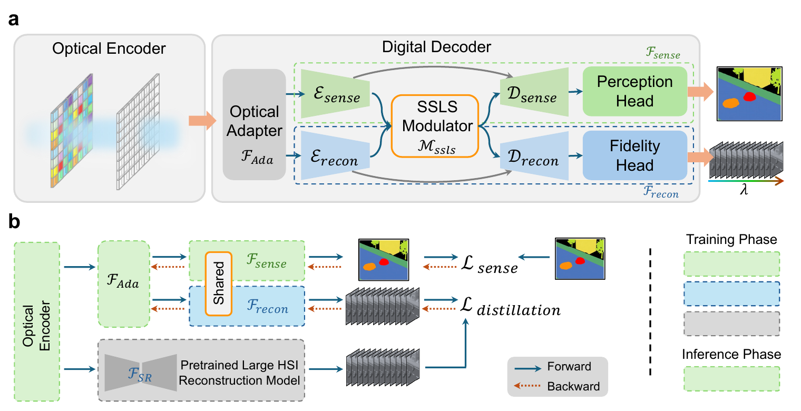

# SPARC

### Spectral Perception Architecture for Real-time Computing

*Low-latency Hyperspectral Visual Perception on a Chip*

**Spectral intelligence begins at capture.**

SPARC brings broadband optical encoding and spectral-prior-guided computation into a unified sensing–computing architecture. Optical acquisition becomes an active stage of inference: the sensor shapes the spectral representation on which perception operates, carrying material-specific information from light into compact digital computation.

A Shared Spectral Latent Space (SSLS) connects optical embeddings, spatial morphology and spectral knowledge during learning. This coordinated optical–digital design supports efficient, material-aware perception with a compact deployed sensing pathway and no intermediate hyperspectral-cube recovery.

## Framework



*Optical–digital architecture and learning framework from Fig. 2a–b.*

- **Broadband optical encoding** forms task-relevant spectral embeddings at acquisition.
- **Shared spectral representation** brings spectral priors and morphology into a coordinated learning process.
- **Compact digital deployment** retains the sensing pathway and its learned spectral representation.

## Getting started

Use Python 3.10 or later and install a PyTorch build appropriate for the target hardware.

```bash
python -m venv .venv
source .venv/bin/activate
python -m pip install --upgrade pip setuptools wheel
python -m pip install -e .
```

For CUDA execution, install the acceleration dependencies after PyTorch:

```bash
python -m pip install -e '.[cuda]' --no-build-isolation
```

Environment requirements and backend selection are described in the [reproduction guide](docs/reproduction.md).

## Pretrained inference

The repository includes a trained sensing checkpoint and five BSEA-RAW examples.

```bash
OMP_NUM_THREADS=2 MKL_NUM_THREADS=2 sparc predict \
  --checkpoint checkpoints/sparc_pretrained.pt \
  --input examples/raw \
  --output runs/predictions \
  --device cpu --backend reference
```

Accelerated execution options are documented in the [reproduction guide](docs/reproduction.md#environment).

See [checkpoint specifications](checkpoints/README.md) and [example data](examples/README.md) for input and model formats.

## Training and evaluation

Configure data paths in [configs/sparc.yaml](configs/sparc.yaml).

```bash
sparc pretrain-teacher --config configs/sparc.yaml --device cuda:0
sparc train --config configs/sparc.yaml --device cuda:0
sparc evaluate --checkpoint runs/sparc/best.pt \
  --split test --output runs/sparc/metrics.json --device cuda:0
sparc export --checkpoint runs/sparc/best.pt \
  --output checkpoints/sparc_inference.pt
```

Data preparation, calibrated optical synthesis and training options are documented in the [reproduction guide](docs/reproduction.md). Module definitions and numerical conventions are provided in [implementation details](docs/implementation.md).

## Repository

```text
configs/       Model and training configuration
src/sparc/     Optical encoding, digital decoding and optimization
checkpoints/   Pretrained sensing parameters
examples/      RAW measurements and calibration
docs/          Framework figure and technical guides
tools/         Calibration restoration
tests/         Numerical and workflow validation
```

## Validation

```bash
python -m pip install -e '.[dev]'
python -m unittest discover -s tests -v
ruff check .
ruff format --check .
```
